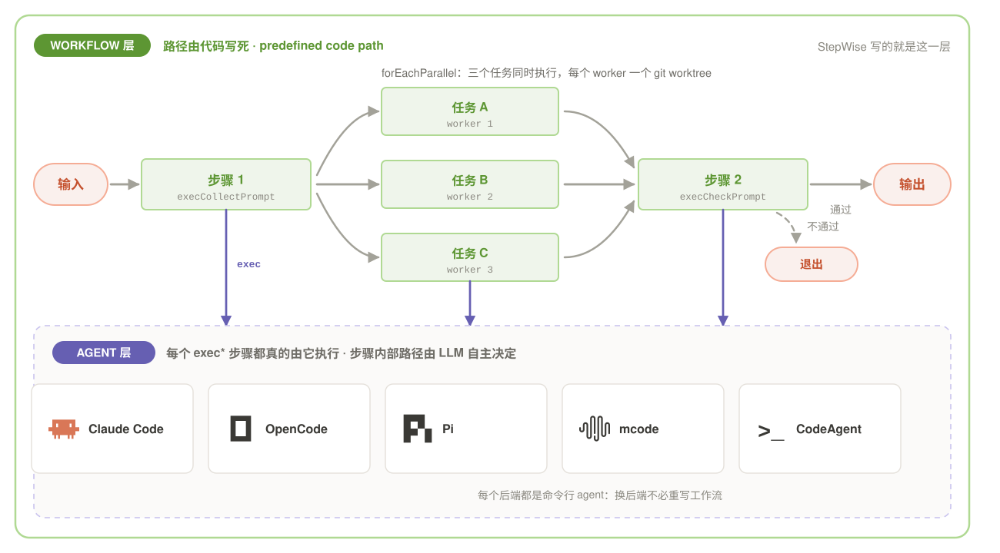

# StepWise

<p align="center">
  <strong>让 AI 独立、准确、可靠地完成无人值守的长任务</strong>
</p>

<p align="center">
  StepWise 是一个 TypeScript SDK，以无头模式驱动 Claude Code / OpenCode / CodeAgent / Pi / mcode。<br>
  高效构建基于 AI agent 的工作流，长任务稳定执行，结果可验证、可追溯、可复现。
</p>

<p align="center">
  <a href="#核心思路">核心思路</a> • <a href="#什么时候需要-stepwise">什么时候需要</a> • <a href="#快速开始">快速开始</a> • <a href="#用法示例">用法示例</a> • <a href="#执行结果目录结构">目录结构</a> • <a href="#文档">文档</a> • <a href="#参与开发">参与开发</a> • <a href="README.md">English</a>
</p>

<p align="center">
  
</p>

---

## 核心思路



StepWise 把 AI agent 组织成一层可编排的工作流：路径由你的代码写死，每一步真的交给 agent 执行，结果可验证、可追溯、可复现。

---

## 什么时候需要 StepWise？

单个任务，AI agent 自己就能稳定完成。真正需要 StepWise 的是**任务数量很大**的时候：同一类任务成百上千个，要一个不漏地跑完，要能中断续跑，要能说清每一步到底做了什么。

StepWise 提供的正是这一套能力：

- **稳定完成。** 每个任务交给 agent 执行，失败自动重试、校验不合格自动生成修复提示重跑；并行任务各占一个 git worktree，互不干扰。
- **断点恢复。** 进程被杀、机器重启、配额耗尽，重跑同一个脚本即可跳过已完成的步骤；429 / 503 用一次性会话探测配额是否恢复，等待不消耗重试预算。
- **过程可追溯。** 每一步的提示词、输出、后检查判定、耗时与 token 全部落盘，任何一步都能原样重跑。
- **工作流可调测。** debug 模式下先跑少量样本，每步都有独立复盘（结论必须逐字引用原文佐证），流程本身可以被验证和修正。
- **可自进化。** 跑通的经验被沉淀成 Skill，agent CLI 下次会话原生加载，同样的坑不必再踩。
- **后端可换。** Claude Code / OpenCode / CodeAgent / Pi / mcode 共用同一套工作流脚本，换后端不必重写。
- **影响范围可控。** `setAllowRead` / `setAllowWrite` 把单步限制在指定目录内——提示词级护栏。

### 什么时候不需要它

边聊边改的交互式开发、只有两三个步骤的小任务、或者只是想借 agent 更强的单次能力，直接用 Claude Code 原生功能更省事。

需要跨机器、分布式、可审计的长时恢复时，也不该用 StepWise——那一层属于 Temporal、Restate 这类持久化执行基础设施，它们为此要引入外部服务与状态存储。StepWise 的取舍正好相反：单进程、零外部依赖、状态全部落在磁盘上，一次运行就是一个可检查、可归档的文件夹。

---

## 快速开始

需要 **Node.js 16+**（构建目标为 `moduleResolution: Node16`），以及 `PATH` 上至少一个 AI 编程助手 CLI——Claude Code（默认）、OpenCode、CodeAgent、Pi 或 mcode。使用 OpenCode 时，请在 `opencode.json` 中设置 `"permission": "allow"`，否则它会不停弹确认。

直接从 npm 安装：

```bash
npm install @dreamcheck/stepwise
```

然后写你的工作流。启动时会打印任务目录和恢复命令——把它作为 `initTask` 的第二个参数传回来，所有已完成的步骤都会被跳过：

```typescript
import { initTask, StepWise } from '@dreamcheck/stepwise';

initTask('RefactorAuth');   // 恢复执行: initTask('RefactorAuth', 'RefactorAuth_20260315_143000_123')
const agent = new StepWise('MainAgent');

await agent.execPrompt('分析模块依赖关系');
await agent.execPrompt('抽取公共接口定义');
await agent.execPrompt('重构核心逻辑');
```

---

## 用法示例

### 1. 任务步骤控制

用真实命令验证每一步，而不是采信 AI 的自述：

```typescript
const build = await agent.execShell('npm run build');
if (!build.success) {
  await agent.execPrompt('修复构建错误');
}
```

### 2. 结构化数据收集

声明想要的格式；第一个必填字段自动用于去重。校验与修复重试默认开启——需要时按步骤微调：

```typescript
const result = await agent.execCollectPrompt('收集所有 API 端点', {
  name: { type: 'string', description: 'API 名称' },
  method: { type: 'string', description: 'HTTP 方法' },
  path: { type: 'string', description: 'API 路径' },
  description: { type: 'string', description: 'API 描述', required: false }
}, {
  validateOptions: { maxRetries: 3, retryOnFileMissing: true }
});
```

### 3. 条件分支

根据条件把任务分发到不同的 Agent：

```typescript
const checkResult = await agent.execCheckPrompt('检查测试是否通过');

if (!checkResult.result) {
  const fixAgent = new StepWise('FixAgent');
  await fixAgent.execPrompt('修复失败的测试');
} else {
  const deployAgent = new StepWise('DeployAgent');
  await deployAgent.execPrompt('部署到预发环境');
}
```

### 4. 并行处理

用一个处理函数跑遍所有条目，各 Worker 相互隔离。想在另一个仓库里执行，追加第四个参数 `{ cwd: '/path/to/other-repo' }`：

```typescript
import { forEachParallel, WorkerConfig, loadCollectData } from 'stepwise';

const apis = loadCollectData('api_endpoints.json');
const workerConfigs: WorkerConfig[] = [{ branchName: 'Worker1' }, { branchName: 'Worker2' }];

await forEachParallel(apis, workerConfigs, async (ctx) => {
  await ctx.stepWise.execPrompt('为 API 生成测试: $name ($method $path)', { data: ctx.item });
});
```

每个 Worker 运行在自己的 worktree 中，会话按目录分别存储。跨 worktree 做 fork（`sessionId` + `newSession: true`）会自动把会话软链过去；单独传 `sessionId` 跨 worktree 会直接报错，而不是冒着并发写坏会话的风险继续。

### 5. Schema 驱动输出

按你定义的 Schema 输出 JSON——支持任意嵌套与递归树形结构：

```typescript
const tree = await agent.execPromptSchema(
  '生成项目的目录树',
  {
    type: 'object',
    recursive: true,
    recursiveFields: ['children'],
    maxDepth: 5,
    properties: {
      name: { type: 'string', description: '文件或目录名' },
      type: { type: 'string', description: "'file' 或 'directory'" },
      children: { type: 'array', description: '子条目（递归定义）' }
    }
  },
  'dir_tree.json'
);
```

### 6. 会话管理

```typescript
const r2 = await agent.execPrompt('实现 CRUD 接口');   // 会话默认自动复用
const sessionId = r2.sessionId;

await agent.execPrompt('开始一个独立的新需求', { newSession: true });
await agent.execPrompt('继续完善', { sessionId });              // 恢复指定会话

const forked = await agent.execPrompt('尝试另一种实现思路', {
  sessionId,                                        // fork：派生新会话
  newSession: true                                  // 原会话保持不变
});
```

### 7. 断点恢复

长任务跑到一半被中断——进程被杀、机器重启、限流打满——重跑时不想从头再来。

启动时框架会打印任务目录名，把它作为 `initTask` 的第二个参数传回来，重跑同一个脚本即可：已完成的步骤自动跳过，断掉的那一步从原地继续。

```typescript
import { initTask, StepWise } from 'stepwise';

initTask('RefactorAuth', 'RefactorAuth_20260315_143000_123');   // 启动时打印的目录名
const agent = new StepWise('MainAgent');

await agent.execPrompt('分析模块依赖关系');   // 上次已完成 → 跳过
await agent.execPrompt('重构核心逻辑');       // 上次没跑到 → 继续执行
```

横幅里打印的 `恢复命令` 用的是已废弃的 `setResumePath`，`initTask(任务名, 恢复路径)` 与它等价。

并行任务同样适用——恢复路径照传，已完成的条目跳过，断在中间的条目重新执行：

```typescript
initTask('BatchJob', 'BatchJob_20260315_143000_123');
await forEachParallel(items, workerConfigs, handler);
```

### 8. 调试模式

写完一条流程，先确认整条链路通不通，再决定要不要跑全量数据。

```typescript
import { initTask, StepWise, enableDebugMode } from 'stepwise';

enableDebugMode(true);   // 收集类步骤只处理 1 条数据

initTask('MyTask');
const agent = new StepWise('MainAgent');

await agent.execPrompt('步骤1：分析项目');
await agent.execCollectPrompt('步骤2：收集数据', fmt);   // 只收集 1 条
```

**debug 模式下的自检复盘**

调试模式下每成功执行一个 AI 步骤，框架会新开一个会话，把这一步的**输入**交给一个独立审查者：步骤提示词、最终输出、该步骤的后检查提示词与判定结果（配置了 `postCheckPrompt` 时），以及提示词明确要求加载的 Skill 文件。审查对象是**输入本身的工作流程与思路**——目标与思路是否清晰、是否需要补充、是否冗余、是否有逻辑错误；模型自身的行为问题（工具调用命令写错、失败重试、重复思考、返工等）不在复盘范围内。

审查者必须逐字引用原文佐证每条结论，引用不到就不输出；报告写在同目录的 `self_check.md`，**无论有没有发现问题都会生成**：没问题就写明「本次执行未发现需要改进的问题。」

debug 模式下 `postCheckPrompt` 也会**真实执行**，因此后检查的要求是否清晰、产出是否满足要求，都在复盘范围内；后检查失败不会中断主流程。

详见[执行结果目录结构](#执行结果目录结构)。

---

## 执行结果目录结构

一次运行就是一个文件夹，位于工作目录下的 `stepwise_exec_infos/`。启动时打印的恢复路径就是这个文件夹名：

```
stepwise_exec_infos/
└── <TaskName>_<YYYYMMDD>_<HHmmss>_<ms>/          ← 一次运行 = 一个文件夹
    ├── logs/
    │   ├── performance.json                     ← 耗时 / token 累计统计（机器可读）
    │   └── performance.txt                      ← 同上，可读版
    ├── report/                                  ← execReport 产出的报告
    │
    └── <AgentName>_<timestamp>/                 ← 每个 Agent / Worker 一个
        ├── data/
        │   └── progress.json                    ← 断点恢复状态（步骤序号、状态、会话 ID）
        ├── logs/
        │   ├── execute.log                      ← 每步的开始 / 结束 / 重试 / 跳过
        │   ├── 1_collect/                       ← 第 1 个 collect 步骤
        │   │   ├── prompt.txt                   ←   任务提示词（本次实际下发的提示词）
        │   │   ├── output.txt                   ←   最终输出
        │   │   ├── verbose_output.txt           ←   思考过程与工具调用全量轨迹
        │   │   ├── command.sh                   ←   可直接 ./command.sh 原样重跑（提示词经管道注入）
        │   │   ├── execution_info.json          ←   命令行、会话 ID、环境变量
        │   │   ├── usage.json                   ←   token 用量（NDJSON 执行器）
        │   │   ├── schema.json                  ←   execPromptSchema 的 schema 定义
        │   │   ├── post_check_prompt.txt        ←   postCheckPrompt 原文
        │   │   ├── post_check_output.txt        ←   后检查的判定结果
        │   │   ├── post_check_command.sh        ←   后检查那次的复现脚本
        │   │   ├── file_missing_prompt.txt      ←   输出缺失重试的提示词
        │   │   ├── file_missing_command.sh      ←   输出缺失重试那次的复现脚本
        │   │   ├── validation_fix_prompt.txt    ←   校验失败修复的提示词
        │   │   ├── validation_fix_command.sh    ←   校验失败修复那次的复现脚本
        │   │   ├── self_check_prompt.txt        ←   自检审查者的提示词（仅 debug 模式）
        │   │   ├── self_check.md                ←   自检报告（仅 debug 模式）
        │   │   ├── self_check_verbose_output.txt←   自检审查者自己的执行轨迹
        │   │   ├── self_check_command.sh        ←   自检审查者的复现脚本
        │   │   ├── error.txt                    ←   失败原因（仅失败时）
        │   │   └── ...
        │   └── 2_task/                          ← 第 2 个步骤，以此类推
        └── collect/
            └── 1_collect/
                └── collect_1.json               ← 收集类任务的输出
```

步骤目录名格式为 `{序号}_{类型}`，类型取自 `exec*` 接口（`task` / `collect` / `check` / `report` / `schema` / `shell`）。按条件出现的文件：

| 文件 | 何时出现 |
|---|---|
| `error.txt` | 该步骤执行失败 |
| `usage.json` | 使用 Claude Code / CodeAgent / mcode 等 NDJSON 执行器 |
| `schema.json` | `execPromptSchema` |
| `post_check_prompt.txt` | 该步骤配置了 `postCheckPrompt` |
| `post_check_output.txt` | 该步骤配置了 `postCheckPrompt`（后检查的判定结果） |
| `post_check_command.sh` | 同上（后检查那次的复现脚本） |
| `file_missing_prompt.txt` / `file_missing_command.sh` | 出现过「输出文件缺失」重试 |
| `validation_fix_prompt.txt` / `validation_fix_command.sh` | 出现过「输出校验失败」修复重试 |
| `summarize_prompt.txt` / `summarize_command.sh` | 会话末尾总结落在该步骤目录内时 |
| `self_check.md` | debug 模式下的自检报告 |
| `self_check_prompt.txt` / `self_check_verbose_output.txt` / `self_check_command.sh` | debug 模式下自检审查者自己的产物（带 `self_check_` 前缀，不覆盖步骤本体的同名文件） |

一个步骤目录里会先后跑好几次执行（步骤本体、后检查、输出缺失重试、校验失败修复、会话末尾总结、自检复盘）。**步骤本体独占无前缀的 `command.sh`**——它始终是「这一步」的复现脚本；其余每次执行都带自己的前缀（`post_check_command.sh`、`file_missing_command.sh`……），与该次执行的提示词记录文件同名前缀，互不覆盖。

没有任何东西是不可还原的：`progress.json` 决定断点续跑从哪继续，`command.sh` 让任何一步都能脱离框架单独重跑，`verbose_output.txt` 保留了 AI 当时究竟看到了什么、做了什么、走过哪些弯路。

---

## 文档

- [API 文档](doc/api_cn.md) — 完整 API 说明
- [示例](demos_cn.md) — 可直接运行的完整示例
- [English](README.md) — English documentation

---

## 参与开发

StepWise 的代码边界清楚，边缘场景有测试兜底，容易上手贡献。

**本地开发**

```bash
git clone https://gitee.com/nodaemon/stepwise.git
cd stepwise
npm install
npm run build            # 产出 dist/
npm test                 # Jest，28 个测试文件
npm run test:coverage
```

**代码地图**

| 目录 | 职责 |
|---|---|
| `src/executors/` | 各 CLI 后端的适配层。`base.ts` 定义 `BaseExecutor` 抽象类（`agentType` / `buildArgs` / `getCommand` / `buildProbeArgs`），`claude.ts` `opencode.ts` `pi.ts` `codeagent.ts` `mcode.ts` 是各自的实现，`ndjsonFormatter.ts` 解析流式输出 |
| `src/utils/` | `validator.ts` 输出校验与修复重试、`sessionLinker.ts` 跨 worktree 会话管理、`performanceTracker.ts` 耗时与 token 统计、`reproScript.ts` 生成 `command.sh`、`promptBuilder.ts` 提示词与自检复盘、`skillResolver.ts` 定位提示词要求加载的 Skill |
| `src/StepWise.ts` | 核心类：步骤调度、断点续跑、恢复、配额等待 |
| `src/forEachParallel.ts` | 并行 worker 池、共享队列、worktree 隔离 |
| `src/types.ts` | 全部公开类型，改动前先确认兼容性 |

**适合上手的方向**

- **接入新的 CLI 后端**：新增 `src/executors/xxx.ts` 并继承 `BaseExecutor`，实现四个抽象方法即可，其余逻辑复用基类
- **补测试**：`tests/` 已按功能拆分，`probeRateLimit`、`selfCheck`、`sessionLinkLog` 等边界场景仍有空间
- **完善文档**：API 说明见 `doc/api_cn.md`，可运行示例见 `demos_cn.md`
- **读实现**：从上方「代码地图」入手，`tests/` 按功能拆分，是最准的行为说明

发现问题或想参与迭代，欢迎提交 Issue 或 Pull Request。

---

## 开源协议

Apache-2.0 — Apache 许可证，第 2 版。详见[协议全文](https://www.apache.org/licenses/LICENSE-2.0)。
